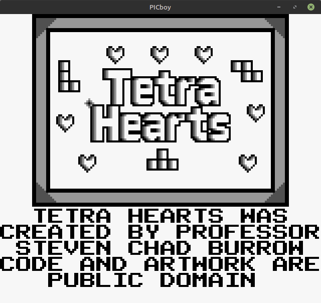
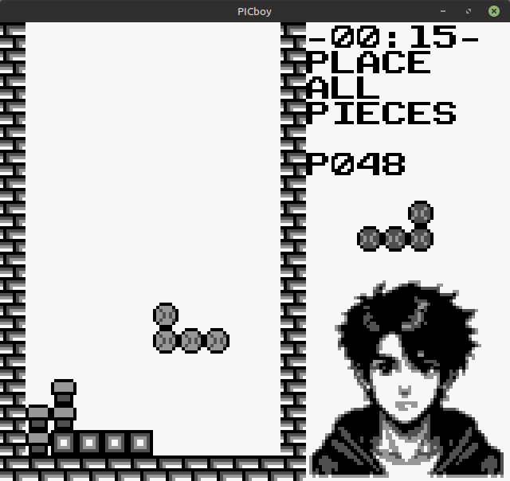
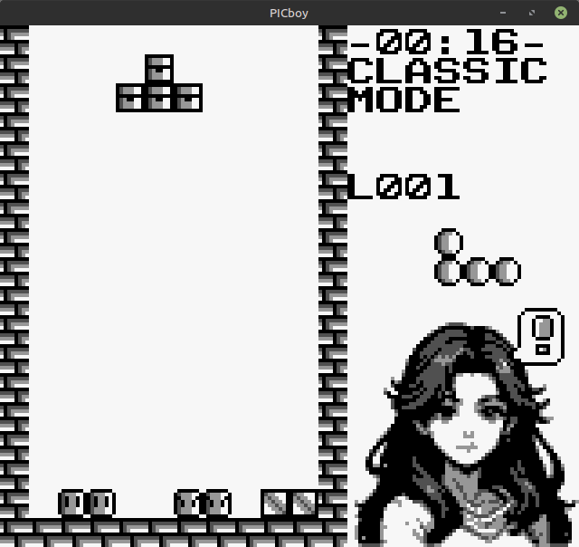
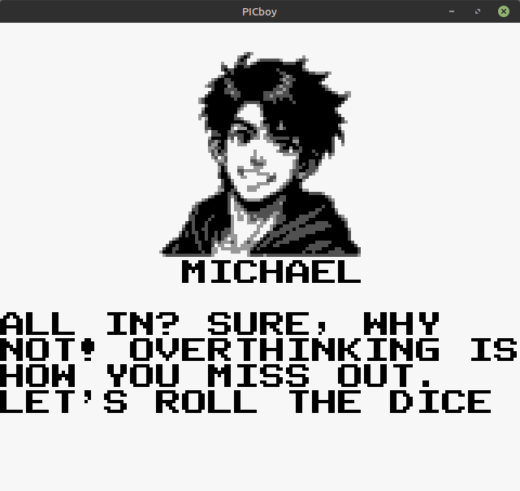
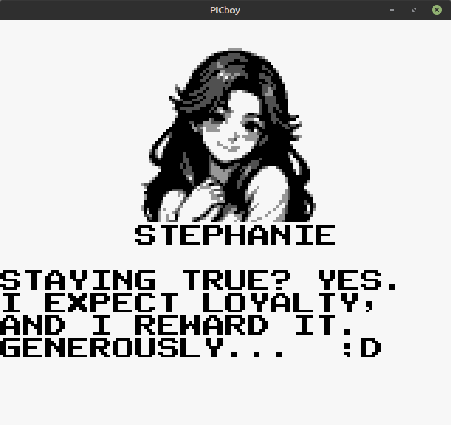

# TetraHearts
Tetra x Dating-Sim for the Gameboy

Uses Gameboy Assembly through <a href="https://rgbds.gbdev.io/">RGBDS</a>.  This is a 32KB No-MBC cart-type for the DMG.

Link to itch.io page:  <a href="https://stevenchadburrow.itch.io/tetra-hearts">https://stevenchadburrow.itch.io/tetra-hearts</a>

At the beginning of every date, you pick a partner:
- Michael, a care-free boy who loves to have fun
- Stephanie, a controlling girl who makes decisions for you
- George, a nervous boy who can open up once in a while
- Jessica, a helpful girl who is inquisitive and caring

You likewise pick a location for your date:
- Cafe, food and coin themed
- Library, book and document themed
- Park, ball and mushroom themed
- Arcade, video game themed

Lastly, you pick a topic of discussion (associated with a challenge type):
- Going all in, drop X pieces
- Staying true, clear X lines
- Letting go, remove X trash
- Opening up, lower from X to 3rd row

Partner dialog changes according to their affection level and choices for the date.  Upon success, the partner's affection level increases.  'Arcade' is specifically for classic Tetra mode, and does not change affection levels.

Audio Controls:
- Start = Change Volume
- Select = Change Track

 
 
 
 
 

